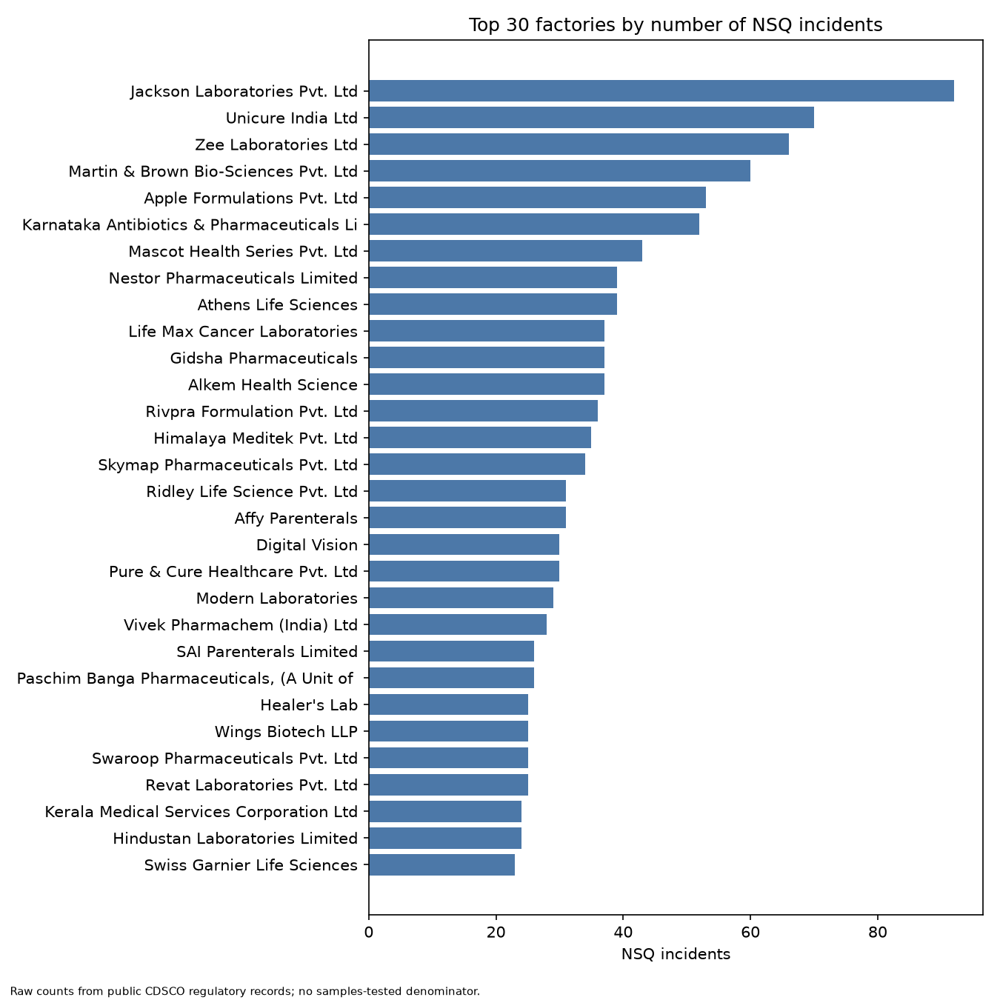
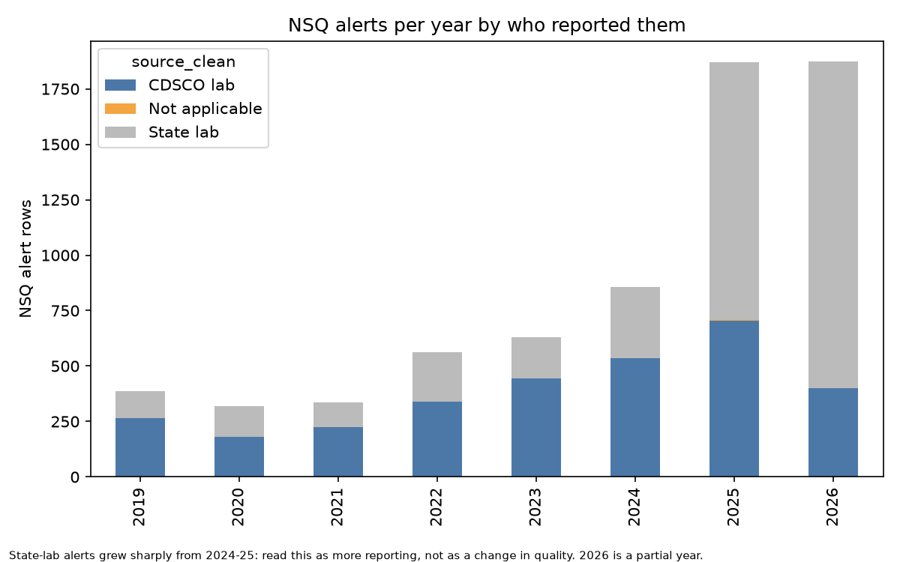
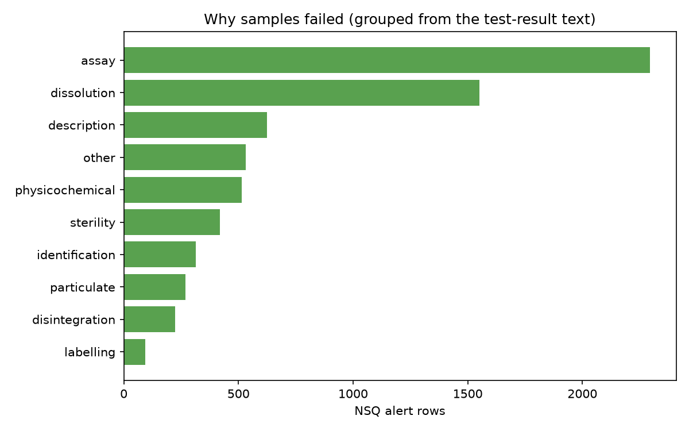
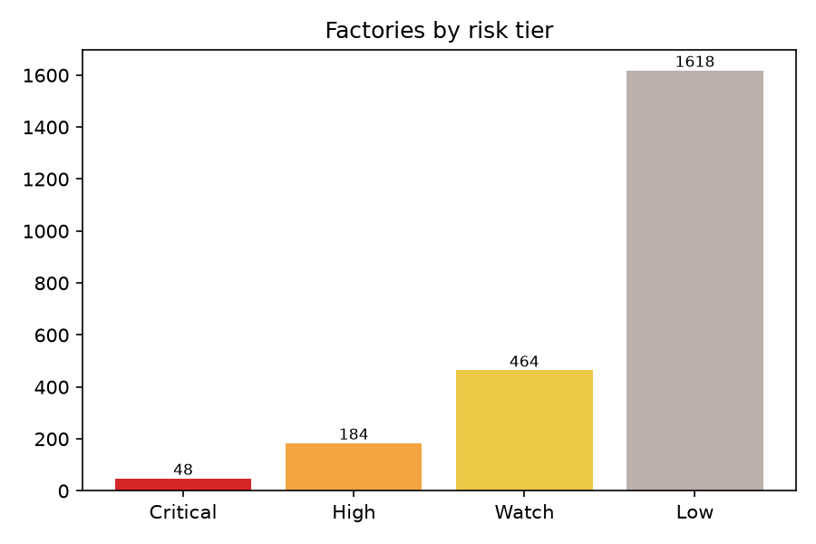
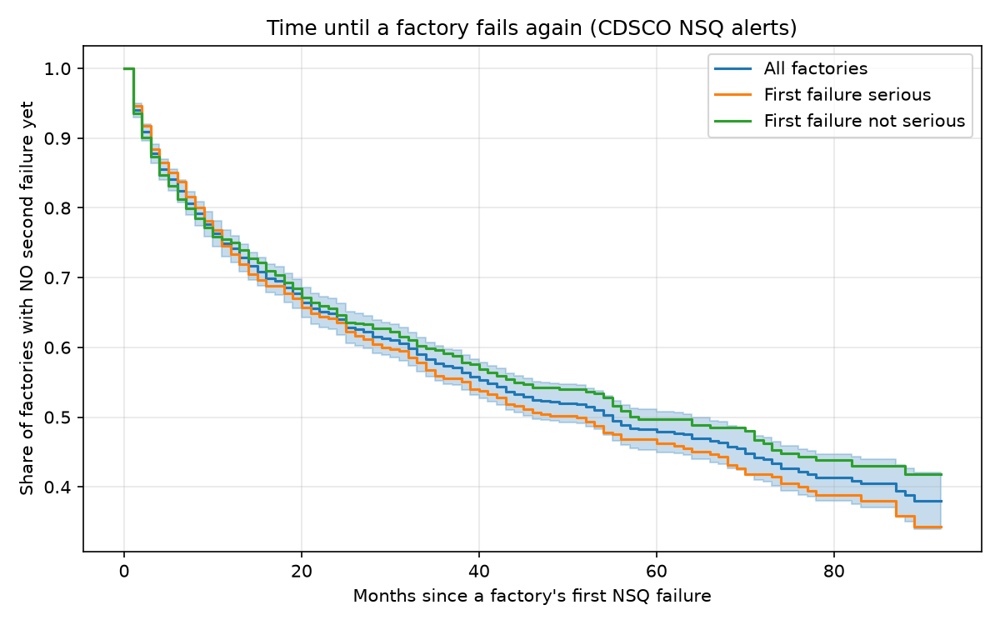
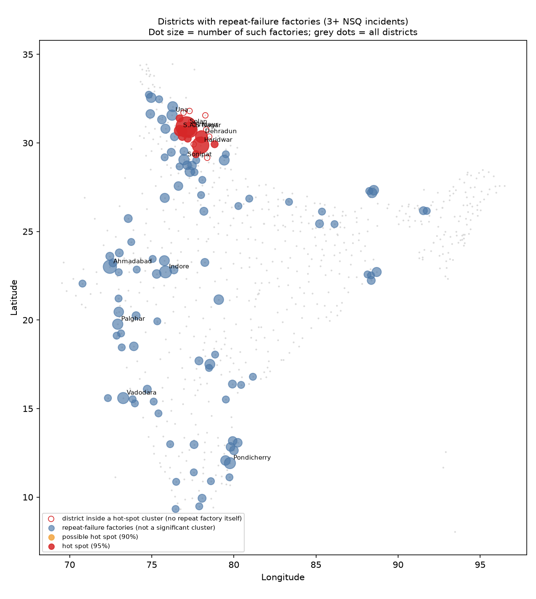

# Manufacturer Quality Risk Index: repeat drug-quality failures in India

Which drug factories in India fail CDSCO quality tests again and again, how soon after a first failure, and where are they concentrated?
This project turns 6,835 public CDSCO "Not of Standard Quality" (NSQ) alert rows (2019 to 2026) into a factory-level dataset, a 0-100 risk score with a time-split backtest, a repeat-failure timing analysis, a count model and a district hotspot map.

**Data source:** CDSCO online NSQ portal, https://cdscoonline.gov.in/CDSCO/viewPublicNSQDrug (public records).

> **Read this first.** Based on public CDSCO regulatory records. Raw counts only: no samples-tested denominator is published, so these are **not failure rates**. An NSQ result applies to one tested batch, not to a whole product or company. Nothing here says that any named company acted wrongly.

## Three headline findings
- About 30% of factories (683 of 2,315) appear in the NSQ alerts in two or more different years, and 631 factories have three or more NSQ incidents.
- About 26% of factories with a first NSQ alert appear in another alert within 12 months, 36% within 24 months (856 of 2,314 have had a second alert so far). The type of the first failure made no clear difference to the timing (p = 0.30).
- Past alerts predict later alerts: trained on earlier years only, the top 10% of factories by score were flagged again in the later years 87% of the time, against 41% for all scored factories (lift 2.1; a plain count of past alerts gave 2.0).

## More results
- Data: 6,835 NSQ alert rows (2019 to 2026; the last year is partial) and 7 spurious rows with a manufacturer name. 2,315 factories grouped under 1,881 companies (spelling variants merged: 495 factories had more than one spelling).
- The jump in alerts per year in 2025 coincides with a large rise in state-laboratory reporting (see chart 2). Do not read the jump as a change in quality.
- Associations from the count model (descriptive, not causal). PIN areas are compared with PIN area 17 (Himachal Pradesh). The share_ lines compare a factory whose failed products are all of that form with one whose failed products are all other forms. Read 'multiple factories' with care (see the methods note):
  - share_injectable: 3.98x (95% range 2.77 to 5.70)
  - share_oral_solid: 3.69x (95% range 2.78 to 4.91)
  - company_has_multiple_factories: 1.87x (95% range 1.53 to 2.27)
  - share_oral_liquid: 1.65x (95% range 1.15 to 2.36)
  - PIN area 24: 1.56x (95% range 1.10 to 2.23)
  - Other PIN areas: 0.64x (95% range 0.48 to 0.86)
  - PIN area 38: 0.49x (95% range 0.33 to 0.72)
  - PIN area 39: 0.47x (95% range 0.28 to 0.78)
  - PIN area 13: 0.45x (95% range 0.26 to 0.77)
  - PIN area 40: 0.42x (95% range 0.24 to 0.72)
  - PIN area 50: 0.34x (95% range 0.20 to 0.58)
  - PIN area 62: 0.33x (95% range 0.14 to 0.78)
- Hotspot test: 11 districts with repeat-failure factories fall in a statistically significant cluster. Largest districts:
  - Solan, Himachal Pradesh: 137 repeat-failure factories, 1142 NSQ incidents (Hot spot (95%))
  - Haridwar, Uttarakhand: 56 repeat-failure factories, 689 NSQ incidents (Hot spot (95%))
  - Sirmaur, Himachal Pradesh: 40 repeat-failure factories, 435 NSQ incidents (Hot spot (95%))
  - Ahmadabad, Gujarat: 22 repeat-failure factories, 207 NSQ incidents (not significant)
  - Dehradun, Uttarakhand: 14 repeat-failure factories, 166 NSQ incidents (Hot spot (95%))
  - Indore, Madhya Pradesh: 14 repeat-failure factories, 163 NSQ incidents (not significant)

## Files
- `CDSCO_NSQ_Project_Workbook.xlsx`: all tables (see the first sheet for a data dictionary).
- `charts/`: 1 top factories, 2 alerts by year and source, 3 failure categories, 4 risk tiers, 5 time until next failure, 6 hotspot map.
- `METHODS_NOTE.md`: how everything was made, and the limits.
- `data/`: every step's data, from the original CDSCO download to the analysis outputs, with its own README explaining each file. How the data flows: **download → split names → match factories → score and analyse → final workbook**. Also includes the superseded first version of the name-splitting step (3,954 rows left for manual review, reduced to 95 in version 2).
- `code/`: the scripts, in the order: downloaders -> `cdsco_manufacturer_parser_v2.py` -> `cdsco_factory_matcher.py` -> `cdsco_analysis.py` -> `cdsco_count_model.py` -> `cdsco_hotspots.py` -> `cdsco_package.py`.

Built 2026-11-02.

## Charts
| | |
|---|---|
|  |  |
|  |  |

## How to reproduce
1. Install Python 3 and the packages: `pip install -r code/requirements.txt`
2. Run the scripts in the order listed under Files above. The scripts were written for Windows and save to `E:\cdsco_mqri`; change that folder path at the top of each script to run them elsewhere.
3. The downloaders fetch the public CDSCO data again. Raw downloads are not stored in this repository.

## Author
Sanskruti Patil
